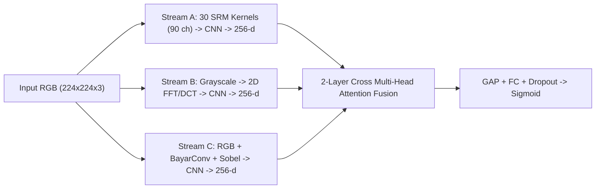

# A Multi-Feature Deep Learning Framework for Detecting AI-Generated Images and Deepfake Media

**Abstract**—The rapid proliferation of generative adversarial networks (GANs), diffusion models, and facial manipulation techniques has made reliable synthetic media detection critical. Single-modality detectors often overfit to generator-specific artifacts and fail to generalize across unseen synthesis methods or post-processing degradations. In this paper, we propose a three-stream forensic deep learning framework that jointly extracts: (1) high-pass **SRM residual features** (90 channels) to capture pixel-level noise traces, (2) **2D FFT / block-wise DCT frequency representations** to expose spectral synthesis artifacts, and (3) **RGB, constrained BayarConv, and Sobel edge features** to capture semantic and boundary inconsistencies. The three 256-dimensional spatial feature streams are tokenized and fused via a **2-layer Cross Multi-Head Attention** module. We evaluate the framework on two separate tracks: **Track A** (AI-generated image detection on GenImage) and **Track B** (deepfake face detection on FaceForensics++ and cross-dataset Celeb-DF v2), alongside ablation, robustness, and Grad-CAM explainability analyses.

---

## I. Introduction
Synthetic media generation has progressed from early GANs to photorealistic diffusion models (e.g., Stable Diffusion, Midjourney, GLIDE, ADM) and facial reenactment/swapping systems. Forensic detectors trained solely on RGB pixels struggle when evaluated on unseen generators or compressed/resized media. Inspired by rich-model steganalysis, MVSS-Net, and LASTED, we design a modular three-stream architecture with cross-attention fusion.

---

## II. Proposed Methodology

1. **Stream A (Residual)**: Applies 30 fixed 5×5 SRM high-pass filters per RGB channel (`groups=3`, 90 output maps, clamped to `[-3, 3]`) followed by a 4-stage CNN (`[B, 256, 7, 7]`).
2. **Stream B (Frequency)**: Converts RGB to grayscale, computes the shifted 2D FFT log-magnitude spectrum (or block-wise 8×8 DCT), normalizes per image, and encodes via a 4-stage CNN (`[B, 256, 7, 7]`).
3. **Stream C (Content & Edge)**: Concatenates RGB (3), constrained `BayarConv2d` (3), and Sobel X/Y edge magnitude (3) into a 9-channel input encoded to `[B, 256, 7, 7]`.
4. **Cross Multi-Head Attention Fusion**: Flattens each stream's `7×7` map into `49` tokens of dimension `256` and applies 2 blocks of multi-head cross-attention (`num_heads=8`) where each stream attends to the other two streams.
5. **Classification & Optional Contrastive Learning**: Uses `BCEWithLogitsLoss` with an optional LASTED-inspired Supervised Contrastive Loss (`SupCon`).

---

## III. Experimental Setup
* **Track A (AI-Generated Images)**: GenImage (BigGAN, GLIDE, Midjourney, SDv1.4, SDv1.5, ADM, Wukong, VQDM).
* **Track B (Deepfake Faces)**: FaceForensics++ (video-wise 70/15/15 split to prevent frame leakage) and Celeb-DF v2 (cross-dataset test).
* **Metrics**: Accuracy, Precision, Recall, F1-score, ROC-AUC, Average Precision, Sensitivity, Specificity, Parameter Count, and Inference Latency at fixed threshold `0.5` across 3 random seeds (`42, 123, 2025`).

---

## IV. Results & Ablation Studies

> [!NOTE]
> Replace `[PENDING]` cells with actual measured values after running `training/train.py`, `training/train_deepfake.py`, and `evaluation/evaluate.py` on the downloaded datasets.

| Experiment | Configuration | Accuracy (%) | F1-Score | ROC-AUC |
| :--- | :--- | :---: | :---: | :---: |
| Exp 1 | Residual Only | `[PENDING]` | `[PENDING]` | `[PENDING]` |
| Exp 1 | Frequency Only | `[PENDING]` | `[PENDING]` | `[PENDING]` |
| Exp 1 | Content Only | `[PENDING]` | `[PENDING]` | `[PENDING]` |
| Exp 2 | Residual + Frequency | `[PENDING]` | `[PENDING]` | `[PENDING]` |
| Exp 2 | Residual + Content | `[PENDING]` | `[PENDING]` | `[PENDING]` |
| Exp 2 | Frequency + Content | `[PENDING]` | `[PENDING]` | `[PENDING]` |
| Exp 3 | 3-Stream + Concatenation | `[PENDING]` | `[PENDING]` | `[PENDING]` |
| Exp 3 | 3-Stream + Dual Attention | `[PENDING]` | `[PENDING]` | `[PENDING]` |
| Exp 3 | 3-Stream + Cross-Attention | `[PENDING]` | `[PENDING]` | `[PENDING]` |
| Exp 4 | 3-Stream + Cross-Attn + SupCon | `[PENDING]` | `[PENDING]` | `[PENDING]` |

---

## V. Limitations & Future Work
* **Frame-Based Video Analysis**: Track B evaluates individual cropped face frames rather than modeling temporal dynamics across consecutive video frames.
* **Computational Cost**: Three-stream feature extraction and cross-attention add latency compared to single-backbone classifiers.

---

## References
1. H. Wu, J. Zhou, and S. Zhang, "Generalizable Synthetic Image Detection via Language-guided Contrastive Learning," *IEEE Transactions on Artificial Intelligence*, 2025.
2. C. Dong, X. Chen, R. Hu, J. Cao, and X. Li, "MVSS-Net: Multi-View Multi-Scale Supervised Networks for Image Manipulation Detection," *IEEE TPAMI*, 2022.
3. B. Bayar and M. C. Stamm, "Constrained Convolutional Neural Networks: A New Approach Towards General Purpose Image Manipulation Detection," *IEEE TIFS*, 2018.
4. J. Fridrich and J. Kodovsky, "Rich Models for Steganalysis of Digital Images," *IEEE TIFS*, 2012.
